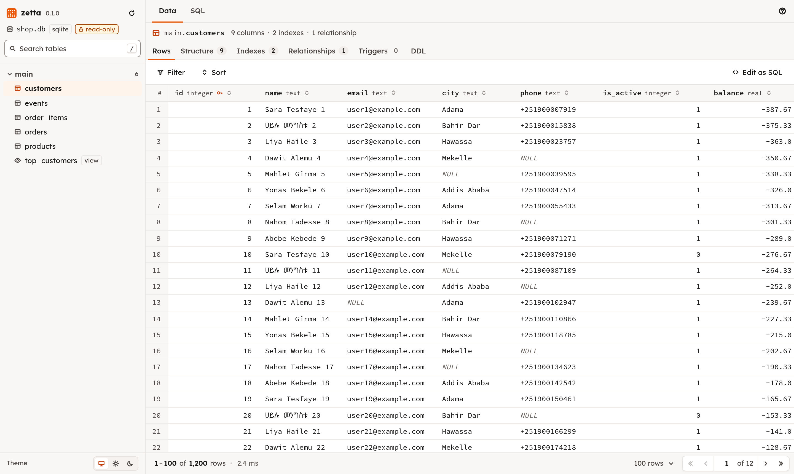

<p align="center"></p>

# zetta

A database explorer for Postgres and SQLite in a single binary under 3 MB. Point it at a database to browse and query it in your browser, or run SQL from the shell.




zetta is in early development. Both databases work in the web UI and the CLI.

## Features

**Browse**
- Every schema, table, view and function, with search, and approximate row counts on Postgres
- A virtualized grid that pages through any table, with column picking and sorting
- Filter and sort with a builder, or write the `WHERE` and `ORDER BY` yourself
- An inspector for each row that formats JSON and follows foreign keys to the row they point at
- Copy cells and rows as CSV, TSV, JSON, JSON lines or Markdown, or save them as a file
- Each table's structure, indexes, triggers, DDL, and a map of its foreign keys in both directions

**Query**
- A SQL editor with highlighting and completion of tables, columns and functions
- Runs the statement at the caret, the selection, or the whole script
- Asks before a statement that destroys data, such as `DELETE` without `WHERE`, `DROP` or `TRUNCATE`
- Stops at 5,000 rows or 64 MB with a button to count every row, and at 30 s with a button to run again for longer
- Every view lives in the URL, so a link opens the same table, filter or query

**Shell**
- `zetta query` prints results as an aligned table, CSV or JSON
- `zetta tables` lists schemas and tables
- Completions for bash, zsh and fish, and an environment variable for every flag

**Safe by default**
- Listens on `127.0.0.1` with a fresh access token each run, and refuses other sites, hosts and origins
- `--read-only` is enforced inside each database adapter, not in the UI
- Passwords are redacted from every message

**Small and self-contained**
- One binary that links nothing but libc, with the UI embedded
- Speaks the Postgres wire protocol itself, TLS included, with no libpq or OpenSSL
- SQLite is compiled in

## Install

Build from source with Zig 0.16.0 and bun:

```sh
cd web && bun install && cd ..
zig build -Doptimize=ReleaseSafe
```

The binary is `zig-out/bin/zetta`. Add `-Dtarget=x86_64-linux-musl` (or another target) to cross-compile; a musl target gives a fully static binary.

## Usage

```sh
zetta ./app.db                                       # browse a SQLite file
zetta postgres://me@localhost/app --read-only        # browse Postgres without writes
DATABASE_URL=postgres://me@localhost/app zetta       # take the database from the environment
```

zetta prints a URL with a one-time token and opens it in your browser. It listens on port 1993, or the next free one.

```sh
zetta query app.db 'select * from users limit 5'
zetta query postgres://me@localhost/app -f csv < report.sql > report.csv
zetta tables app.db
```

A database is a `postgres://` URL, a Postgres keyword string (`host=... dbname=...`), `sqlite:<path>`, or a path ending in `.db`, `.sqlite` or `.sqlite3`. `ZETTA_DSN` or `DATABASE_URL` keeps a password out of the process list. Run `zetta <command> --help` for every option.

| Command | Does |
|---|---|
| `serve [DSN]` | Serve the web UI (the default) |
| `query <DSN> [SQL]` | Run SQL and print the result; SQL comes from stdin when omitted |
| `tables <DSN>` | List schemas and tables |
| `completion <SHELL>` | Print a completion script for bash, zsh or fish |

`--read-only` opens SQLite read-only. On Postgres it runs your SQL one statement at a time in read-only transactions, refuses `DO` and `CALL`, and resets the session after each request. For a hard guarantee, connect as a read-only role.

## Postgres support

- `postgres://` URLs and keyword strings parsed as libpq does, `PG*` environment variables and `~/.pgpass`
- SCRAM-SHA-256, MD5, cleartext password and trust
- Every `sslmode` from `disable` to `verify-full`, with `sslrootcert=<file>` or the system store
- TCP, IPv6 and Unix sockets
- Not supported: channel binding, client certificates, Kerberos, multiple hosts and `COPY FROM STDIN`

## Docker

```sh
docker build -t zetta .
export ZETTA_TOKEN=$(openssl rand -hex 16)
docker run --rm -p 127.0.0.1:1993:1993 -e ZETTA_TOKEN -e DATABASE_URL=postgres://user:password@db:5432/app zetta
```

The image is the static binary on `scratch`, running as a non-root user. Inside the container zetta listens on `0.0.0.0`, so it needs `ZETTA_TOKEN`: 16 to 64 letters, digits and `- . _ ~`. It serves plain HTTP, so publish the port on `127.0.0.1` unless a TLS proxy is in front, then open `http://localhost:1993/?token=$ZETTA_TOKEN`.

## Development

```sh
zig build check                                                            # format check and full build
zig build test                                                             # unit tests and the adapter suite
ZETTA_TEST_PG_URL=postgres://... zig build test test-oracle -Dpg-oracle=true   # also on Postgres, compared with libpq
dev/pg-matrix.sh                                                           # auth, TLS and sslmode against real servers in Docker
cd web && bun run check                                                    # types, lint and UI tests
cd web && bun run dev                                                      # UI dev server, proxies /api to zetta on port 1993
```
