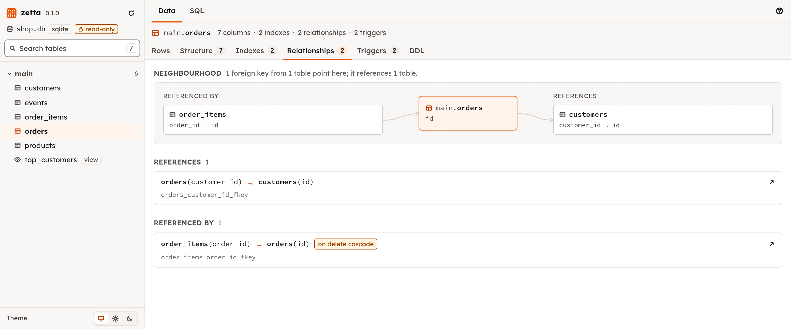

<p align="center"></p>

# zetta

A small database explorer for Postgres and SQLite that runs as a single binary. Point it at a database to browse, filter and query it in your browser, or run SQL from the shell.




The screenshots show the sample shop from `dev/seed.sql`, opened with `--read-only`.

## Status

Early development. Postgres and SQLite work in both the web UI and the CLI.

## Features

- A browser UI embedded in the binary, with no runtime and no separate assets
- Lists every schema, table and view, with approximate row counts on Postgres
- Shows column types and primary keys
- Browses tables with a `WHERE` filter, `ORDER BY`, column sorting, paging and collapsible columns
- Runs arbitrary SQL, with Ctrl+Enter in the UI or `zetta query` in the shell
- Prints results as an aligned table, CSV or JSON
- Has a read-only mode
- Binds to `127.0.0.1` by default and requires a per-run token
- Generates shell completions for bash, zsh and fish

## Requirements

- Zig 0.16.0
- bun (to build the web UI)

SQLite is compiled in.

## Build

```sh
cd web && bun install && cd ..
zig build -Doptimize=ReleaseSafe
```

The binary is written to `zig-out/bin/zetta`, about 2.2 MB, and links nothing but libc. ReleaseSafe is the release mode: zetta keeps its bounds and overflow checks, while SQLite is built without them and runs as fast as in ReleaseFast. ReleaseSmall saves about 0.8 MB but runs queries 1.5 to 2 times slower. `zig build` runs `bun run build` in `web/` first. Pass `-Dui=prebuilt` to use an existing `web/dist/index.html.gz` instead.

| Option | Description |
|---|---|
| `-Dtarget=x86_64-linux-musl` | Cross-compile; a musl target gives a fully static binary |
| `-Dcommit=<hash>` | Commit shown by `--version` when there is no `.git` |

## Usage

```sh
zetta ./app.db
zetta serve postgres://me@localhost:5432/app --read-only
DATABASE_URL=postgres://me@localhost/app zetta
```

On startup zetta prints a URL that contains a one-time token. Open it in your browser. The token is exchanged for a session cookie, and requests without it are refused.

```sh
zetta query app.db 'select * from users limit 5'
zetta q postgres://me@localhost/app -f csv < report.sql > report.csv
zetta tables app.db
```

A database is given as `postgres://...`, a Postgres keyword string (`host=... dbname=...`), `sqlite:<path>`, or a path ending in `.db`, `.sqlite` or `.sqlite3`. zetta never creates a missing SQLite file. The database can also come from `ZETTA_DSN` or `DATABASE_URL`, which keeps a password out of the process list.

| Command | Description |
|---|---|
| `serve [DSN]` | Serve the web UI (the default command) |
| `query <DSN> [SQL]` | Run SQL and print the result. SQL is read from stdin when omitted |
| `tables <DSN>` | List schemas and tables |
| `completion <SHELL>` | Print a completion script for bash, zsh or fish |

Run `zetta <command> --help` for every option. Each option has an environment variable, and the precedence is command line, then environment, then default.

The SQL tab and `query` run any statement with the privileges of the connecting role. With Postgres, `--read-only` sets `default_transaction_read_only`, which a statement can turn off again. For a hard guarantee, connect as a read-only role.

`serve` listens on port 1993, or on the next free port when 1993 is taken, and says which. A port given with `--port` or `ZETTA_PORT` is used as is, and zetta stops if it is taken. `--port 0` lets the system pick one.

In the web UI, a browse or a SQL tab query stops after 30 seconds and reports a timeout. Change that with `--statement-timeout` in milliseconds, or turn it off with 0. The `query` command has no limit.

## Postgres support

zetta speaks the Postgres protocol itself; there is no libpq or OpenSSL.

- Connection strings: `postgres://` URIs and `key=value` strings, parsed as libpq does, plus `PG*` environment variables and `~/.pgpass`.
- Authentication: SCRAM-SHA-256, MD5, cleartext password and trust.
- TLS: every `sslmode` from `disable` to `verify-full`, with `sslrootcert=<file>` or `system`. With `verify-ca` or `verify-full` and no `sslrootcert`, the system certificate store is used.
- TCP, IPv6 and Unix sockets (`/run/postgresql`, then `/tmp`).
- Not supported: channel binding, client certificates, Kerberos/GSSAPI, multiple hosts, and `COPY`.

## Docker

The image is a single static binary on `scratch`: under 1 MB to pull, and it runs as a non-root user. The build cross-compiles, so one machine builds both architectures (`docker buildx build --platform linux/amd64,linux/arm64 .`).

```sh
docker build -t zetta --build-arg ZETTA_COMMIT=$(git rev-parse --short HEAD) .
```

```sh
docker run --rm -p 1993:1993 -e ZETTA_TOKEN=change-me -e DATABASE_URL=postgres://user:password@db:5432/app zetta
```

```sh
docker run --rm -p 1993:1993 -e ZETTA_TOKEN=change-me -v "$PWD/app.db:/data/app.db:ro" zetta serve /data/app.db --read-only
```

Inside the container zetta listens on `0.0.0.0`, so it refuses to start without `ZETTA_TOKEN`. Open `http://localhost:1993/?token=<your token>`. The CLI works too: `docker run --rm zetta query <dsn> "select 1"`.

## Shell completion

```sh
zetta completion bash > ~/.local/share/bash-completion/completions/zetta
zetta completion zsh > "${fpath[1]}/_zetta"
zetta completion fish > ~/.config/fish/completions/zetta.fish
```

## Development

```sh
zig build check   # format check and full build
zig build test    # unit tests and the adapter conformance suite
ZETTA_TEST_PG_URL=postgres://... zig build test   # also run the suite on Postgres
ZETTA_TEST_PG_URL=postgres://... zig build test-oracle -Dpg-oracle=true   # compare with libpq, needs libpq installed
dev/pg-matrix.sh  # auth methods, TLS and sslmode against real servers in Docker
cd web && bun run dev   # UI dev server, proxies /api to zetta on ZETTA_PORT or 1993
```
